# Antigravity IDE Local Proxy Quota Monitoring Reference

> updated 2026-10-25 · v1.34.0

This reference document explains the architecture, flow, and implementation details of local quota monitoring for the Google Antigravity IDE & CLI in this project.

## Multi-Surface Directory Structure & Settings

| Surface | Data & Storage Path | Primary Settings File | Note |
| :--- | :--- | :--- | :--- |
| **AGY CLI** | `~/.gemini/antigravity-cli/` | `settings.json` | JSON format. Holds `permissions.allow` for auto-approving terminal commands. |
| **AGY Desktop App** | `~/.gemini/antigravity/` | `user_settings.pb` | Protobuf format for UI settings. Shares the CLI's sign-in and its `antigravity-cli/conversations/` store: the account signed in last on either surface is the one both use on their next start (`docs/ref/antigravity-multi-account-ram-credentials.md` § 4). |
| **AGY IDE** | `~/.gemini/antigravity-ide/` | `user_settings.pb` | Protobuf format for IDE extension settings. |

*Shared auth credentials live at `~/.gemini/oauth_creds.json` and `~/.gemini/google_accounts.json`.*


## Mechanism of Action

The Antigravity IDE (Gemini-based desktop agent coding environment) runs a local native Language Server instance (`language_server_macos_arm`, `language_server_macos_x64`, etc.) which exposes local Connect RPC APIs. 

Instead of making external network requests to Google Cloud Code APIs (which return simulated/dead data with `0%` usage), our tool queries this local server directly to fetch real-time, accurate quota metrics across all active pools (Gemini, Gemini 4 Argon, and Claude/OSS pools).

## Flow of Action

Quota retrieval is executed by the self-contained POSIX shell script [get-antigravity-usage.sh](../../scripts/get-antigravity-usage.sh) compiled directly into the Tauri Rust backend.

```mermaid
sequenceDiagram
    participant Rust as Tauri Rust Backend
    participant Shell as POSIX sh (sh / ssh)
    participant OS as OS Process Table (ps)
    participant PORT as lsof / ss / netstat (Port Scan)
    participant AG as Antigravity Language Server
    
    Rust->>Shell: Pipe get-antigravity-usage.sh contents
    Shell->>OS: Execute 'ps auxww'
    OS-->>Shell: Process list stdout
    Shell->>Shell: Match language_server binary & extract CSRF token / seed port
    Shell->>PORT: Execute 'lsof' (macOS) or 'ss'/'netstat' (Linux)
    PORT-->>Shell: List of listening TCP ports
    Shell->>AG: Probe ports via curl (POST /RetrieveUserQuotaSummary with CSRF)
    AG-->>Shell: Response 200/401 (identifies active port)
    
    rect rgb(20, 30, 40)
        Note over Shell,AG: Connect RPC Queries
        Shell->>AG: Query GetUserStatus (POST via curl)
        Shell->>AG: Query RetrieveUserQuotaSummary (POST via curl)
        AG-->>Shell: Return email & plan status
        AG-->>Shell: Return detailed groups/buckets quota
    end

    opt an agy CLI session is running
        Shell->>Shell: agy -p "/usage" --output-format json (cached 1 min)
    end
    Shell->>Rust: Output delimited JSON frames (|||AGPROC|||...)
    Rust->>Rust: Parse frames & serialize for Vue Frontend
```



### 1. Process Detection (Multi-Instance: IDE & CLI agy)
* **Execution:** Runs `ps auxww` on macOS/Unix to output the command list without line truncation.
* **Targeting:** Detects both Antigravity IDE and standalone `agy` CLI processes running simultaneously:
  * **IDE Language Server binaries:** `language_server_macos_arm`, `language_server_macos_x64`, `language_server_linux_x64`, `language_server_linux_arm64`, `language_server_windows_x64.exe` (with `--csrf_token` and `--extension_server_port`).
  * **AGY CLI binary:** Standalone `agy` process instances. Detected only; their quota comes from the CLI source below, not from RPC.
* **Argument Extraction (language server only):** Parses the command arguments using regular expressions to extract:
  * `--csrf_token` (Security token required for Connect RPC queries).
  * `--extension_server_port` (Base extension communication port).

### 1b. agy CLI source — `agy -p "/usage"`
* **Why not RPC:** `agy` (1.4.2, Mac and Linux, observed 2026-10-19) hosts its language server inside the `agy` process, whose argv is just `agy` - no `--csrf_token`, no `--extension_server_port`. Its ports answer `401 {"code":"unauthenticated","message":"unauthenticated: missing CSRF token"}` to both RPCs, and the token is only exported into commands agy itself spawns (`ANTIGRAVITY_LS_ADDRESS`, `ANTIGRAVITY_CSRF_TOKEN`). The former agy RPC branch of the script could never succeed and was removed; it used to leave the card silently showing the last cached reading.
* **The read:** when `ps` shows at least one `agy` session, the script runs, once per poll, `agy -p "/usage" --output-format json --log-file <mktemp>` from `/` with stdin closed. agy's changelog (1.1.11, bundled at `~/.gemini/antigravity-cli/cache/CHANGELOG.md`) documents print-mode `/usage` as answered "without starting an agent turn, spending quota, or leaving a conversation behind"; measured `total_tokens: 0`. Output: `command.data.groups[]{name, description, buckets[]{id, name, window, remaining_fraction, reset_time, description?}}` with UTC timestamps.
* **Email:** `/usage`, `/credits`, `/config` and `/help` carry no account. agy logs `OAuth: authenticated successfully as <email>` on every start; `--log-file` points that log at a temp file the script reads and deletes. No credential file is read. A run whose log names no email emits no frame (logged by name), since the cache is keyed by email.
* **Account semantics:** a print-mode run signs in from the on-disk account, so it reports the account new `agy` runs use. A long-running session pinned to another account in RAM (`docs/ref/antigravity-multi-account-ram-credentials.md`) is not what this frame shows; the card labels the reading with the email it really belongs to. The desktop app shares this on-disk account but its `desktop` frame reports the account its own language server holds in RAM, so after a sign-in on the CLI the two frames can name different accounts until the desktop app restarts (ref § 4).
* **Cost and cache:** one run costs ~3-4 s wall, ~1.3 CPU-s and ~200 MB RSS (measured on the Linux dev box); 6.7 s wall on the Mac with three agy sessions running (2026-10-19), well inside the 30 s `REMOTE_SCRIPT_TIMEOUT_SECS`. The frame is cached in `${TMPDIR:-/tmp}/aki-devsync-agy-usage.<uid>` (mode 600) and reused while under 1 minute old (`find -mmin -1`), so a 30 s poll runs agy at most once a minute; a failed run writes nothing.
* **Frame and mapping:** the script emits a normal `|||AGPROC|||` frame with `TYPE cli`, `STATUS {"email":...}` and the raw `/usage` JSON as `SUMMARY`. `quota_summary_from_cli_usage` in `antigravity_payload.rs` renames it onto the `RetrieveUserQuotaSummary` shape (`id`→`bucketId`, `name`→`displayName`, `remaining_fraction`→`remainingFraction`, `reset_time`→`resetTime`); a field agy omits stays absent, so the card never reads a null as 0 %. A `cli` frame without `command.data.groups` is dropped.
* **Binary resolution:** static `[ -x ]` candidates first (`$HOME/.local/bin/agy`, `/opt/homebrew/bin/agy`, `/usr/local/bin/agy`), then `command -v agy` (tauri.A2).
* **Updates:** agy updates itself in the background; `~/.gemini/antigravity-cli/updater/update_status.json` read `"Already on the latest version."` on 2026-10-19 with 1.4.2 installed on both the Mac and the Linux dev box.

### 2. Port Discovery & Probing
* **TCP Port Detection:** Runs `lsof -nP -iTCP -sTCP:LISTEN -a -p <PID>` to gather active ports listening on each target process ID (both IDE and CLI).
* **Seed Ports:** Seeds candidate lists with extracted `extensionServerPort` and adjacent ports (`port + 1`).
* **Connection Probing:** Sends POST requests to `/exa.language_server_pb.LanguageServerService/RetrieveUserQuotaSummary` (probing HTTPS and HTTP) to check for valid Connect RPC statuses (`200` or `401`).

### 3. API Query & Standardization
* **Sequential Queries:** Performs two Connect RPC queries one after the other with `curl`:
  * `GetUserStatus`: Fetch account information such as `email`.
  * `RetrieveUserQuotaSummary`: Fetch detailed quota metrics (5h and Weekly buckets for Gemini, Gemini 4 Argon weekly pool, and Claude/OSS pools, including disabled status flag).
* **Output Mapping:** Merges the results into a standardized JSON snapshot containing:
  * `email`: User account email.
  * `models`: Autocomplete/model metadata (for backward compatibility).
  * `quotaSummary`: Structured list of groups and buckets, including remaining fractions and reset times.

## Signed-Out Detection & usage-flow stability (fixed 2026-07-03, 1.9.1)

When the user is signed out while the language server is still running, `GetUserStatus` does **not** reliably return `401`. On the current Antigravity build it returns **HTTP `500`** with body `{"code":"unknown","message":"GetCascadeModelConfigData() is nil"}` - the server answers, but has no session, so the account-derived model config is nil (empirically verified on this machine after a real logout). The earlier code assumed signed-out == `401`, so it mislabeled this as a generic connection failure. `get-antigravity-usage.sh` sends raw RPC responses inside delimited frames,

- classic: HTTP `401` / `unauthorized`
- current: HTTP `500` matching `is nil` / `GetCascadeModelConfigData`

**Root cause of the "usage keeps erroring / unstable" report:** the probe script itself is 100% stable while the IDE runs (measured 8/8, ~175 ms). The instability was purely in error surfacing: `get_antigravity_usage` in `agent_usage/antigravity.rs` only swallowed `"is not running"` / `"Not authenticated"` / `"command not found"` to `Ok(None)`, and returned `Err` for every other transient case - port not open yet, IDE mid-restart, a single RPC timeout, and the signed-out `500`. Each `Err` set `error.value` in the frontend monitor (khi đó là `useAgentUsage.js`; sau refactor 1.20.0 là `usageMonitor.js`), flashing an error banner every poll. AG usage is a best-effort monitor and the frontend already has a graceful null path (show the last cached account), so `get_antigravity_usage` now maps **any** non-zero script exit to `AgentUsageResult::miss` (or `unreachable` when ssh could not reach the host) and logs the reason at debug level. Result: transient/offline/signed-out states show the cached account (or the "Not connected - open & sign in to Antigravity to monitor" empty state), never a repeating banner.

## Log Out (removed 1.23.0)

The Antigravity account dropdown's **Log Out** row and the `logout_antigravity` / `logout_antigravity_cli` Tauri commands (and `src-tauri/src/agent_usage/antigravity_logout.rs`) were removed from the app in 1.23.0 - see [CHANGELOG.md](../../CHANGELOG.md) under `### [1.23.0] - 2026-08-01` → Removed. Antigravity usage probing (this whole doc otherwise) is unaffected; only the in-app sign-out action is gone.

## Execution Environment

The script is compiled into the Tauri binary via `include_str!` inside [antigravity.rs](../../src-tauri/src/agent_usage/antigravity.rs) and executed in a POSIX shell using `sh` for local targets or `ssh <host> sh` for remote targets.

## Stability and Performance

* **Zero Plugin Conflicts:** By targeting the native binary `language_server_` names rather than a generic `"language-server"` search, it avoids false matches with external plugins like Volar's `language-server.js` or `cssServerMain` which run inside the Antigravity IDE directory.
* **Low latency:** Directly executing our raw shell script avoids spawning `npx` or Node interpreters over remote shells; the IDE path takes ~40ms. A poll that has to run `agy -p "/usage"` takes ~3-7 s instead (at most once a minute, § 1b), inside the same `spawn_blocking` probe, so the UI never waits on it.

---

## Per-Account Cache (localStorage) & Account Dropdown

Antigravity can switch the logged-in account on the same machine, so usage is cached **per account per machine** in `localStorage` under `aki-antigravity-usage-cache-v4`. The whole cache is owned by `src/composables/usageAccountCache.js` and reached only through its functions — no component parses it:

```json
{
  "accounts": {
    "local|user@a.com":  { "data": { ...usage, "email": "user@a.com", "sourceType": "cli" }, "fetchedAt": 1751430000, "host": "local" },
    "local|user@b.com":  { "data": { ... }, "fetchedAt": 1751420000, "host": "local" },
    "devbox|user@a.com": { "data": { ... }, "fetchedAt": 1751430500, "host": "devbox" }
  },
  "lastActiveKeyByHost": { "local": "user@a.com", "devbox": "user@a.com" }
}
```

* **Account identity = email, nothing else (v4, 2026-07-30).** A Google account has ONE quota regardless of which local surface (IDE, CLI, desktop) is running. `sourceType` is transport metadata — it records HOW the data was collected (icon/badge), not WHICH quota it belongs to. One email = one cache entry = one quota. Two entries for the same email on the same host are the same quota: the cache and the dedup in `antigravity_payload.rs` both key on email alone.
* **Why the host is in the key** (v3, 1.20.0): the same Google account is routinely signed in on the Mac and on a remote host at once. v2 keyed on `email` (with host as advisory metadata), so both machines wrote the one key — whichever polled last overwrote the other's reading. Two records that share a key cannot be told apart by metadata; only by the key. `lastActiveKeyByHost` (per-host pointer) replaced the former global `lastActiveEmail` for the same reason.
* **Migration chain:** `aki-antigravity-usage-cache` (v1 single blob) → v2 (per-account) → v3 (`host|email:sourceType`) → v4 (`host|email`). Each step runs once on load and removes the old key. v3→v4 collapses sourceType variants keeping the freshest entry per (host, email) — no reading is lost.
* **`sourceType` in the dropdown row** is the most-recently-observed surface — drives the icon (terminal = CLI, logo = IDE). It updates on every live fetch and is NOT used for deduplication or as a cache key.
* **Account dropdown:** clicking the email in the AG header (`AgentUsage.vue`) opens a dropdown listing every cached account (one row per email), newest first, with its cached-ago time and a «live» dot on the active one. Selecting a non-active account pins the view (`slotViewingEmail` in `AgentUsageSlot.vue`, persisted per slot). **The pin is an email-only handle** — it matches any surface (IDE or CLI) running that account, so switching between surfaces does not strand the card on a stale cache entry. **The monitor's `data` is the full parsed payload** (including `allAccounts`); `AgentUsageSlot.vue`'s `slotAccountInfo` computed resolves the right account for display — that separation is what lets two slots show two different accounts from the same monitor.
* **Sau refactor 1.20.0** mỗi monitor là một entity riêng theo `monitorId(agentId, host)` (`usageMonitorRegistry.js`), nên mỗi `antigravity@<host>` giữ danh sách account của riêng nó.

> **Contrast with Claude Code:** CC deliberately has **no** multi-account cache - exactly one account per remote host by design (see `usage-claudecode.md`). Only Antigravity uses this store.

## Dynamic N-Tier Grid Architecture (`usageTierStore.js` & `AgentUsageSection.vue`)

The usage section uses a declarative, standardized N-Tier slot architecture:

* **Generated, not listed (`MAX_TIER_ROWS`):** Row/slot ids are derived, not hardcoded — `slotIdAt(index)` maps a flat index to a letter (`0` → `A`, `1` → `B`, ...), `rowSlotIds(rowIndex)` gives one row's pair, `allSlotIds()` gives every addressable slot up to `MAX_TIER_ROWS * SLOTS_PER_ROW`. The old literal `ALL_TIER_ROWS` two-row array was the real ceiling on the whole feature — any `tierCount` above 2 sliced past its end and rendered nothing. Raising `MAX_TIER_ROWS` (currently 4 → 8 slots) is now the only edit needed; every consumer (template, popup positioning, per-slot defaults) follows automatically.
* **Zero Template Duplication:** A nested `v-for` renders `activeTierRows` dynamically based on `tierCount`. Adding N tiers requires zero HTML template edits.
* **User Control:** The App Titlebar Menu (☰) has a `Usage slots:` `<select>` (2/4/6/8 slots, filling two per row) instead of a fixed row-count button pair, so the option list grows with `MAX_TIER_ROWS` without widening the menu. The picker talks to the user in slots; `localStorage` (`aki-usage-tier-count`) still stores rows, the same unit and key it always used — `rowsToSlots`/`slotsToRows` in `usageTierStore.js` are the only place the two units meet.
* **Per-slot defaults beyond A-D:** `usageSlotStore.js`'s `defaultTarget(slotId)` keeps the historical A/B/C/D opening views (so an upgraded install looks unchanged) and falls back to local Claude Code for any new slot — never a remote default, which would resolve to an empty host and show an error card before the user ever picks one.
* **Popup opening corner:** `AgentUsageSlot.vue`'s `popupPosition` derives which corner a slot's account menu unfolds from out of the slot's grid position (`slotIndexOf` + `SLOTS_PER_ROW`) instead of a hardcoded per-letter switch, so a bottom row's popup opens upward instead of into the section's `overflow-y: auto` clip.

## Log Out behavior & cache retention (PO decision, chốt 2026-07-07 - nguồn chân lý)

> **Historical note (1.23.0):** the in-app **Log Out** action this section describes (`resetAccount()`, the dropdown row) was removed - see the "Log Out (removed 1.23.0)" section above. The cache-retention rationale, the regression history, and the design locks below still govern how the multi-account cache behaves (an account can still go stale/inactive without an explicit logout), so they are kept for context.

**Mục tiêu của cache multi-account**: xem được hiện trạng lần cuối (last-known state) của **từng** account, vì AG native chỉ hiển thị được 1 account tại 1 thời điểm. Cache tồn tại để bù đắp đúng giới hạn đó - không phải để "dọn dẹp" hay "ẩn" tài khoản không còn active.

- **Sau khi Log Out 1 account trong app**: header hiện **như bình thường** - không có xử lý đặc biệt, không blank/reset về trạng thái trống. `resetAccount()` chỉ kích một lần `checkUsage()` ngay (đẩy nhanh việc phát hiện account mới nếu người dùng sắp login lại) - **không** xóa `data`, `activeEmail`, `viewingEmail`, hay bất kỳ entry nào trong `accounts`. Chấm "live" (`ag-live-dot`) đã tự nhiên di chuyển sang account mới active ngay khi nó có live fetch đầu tiên - không cần thêm indicator/badge riêng cho "account này vừa logout".
- **Thời hạn giữ trong dropdown: vô hạn.** Không có cơ chế dọn theo thời gian/số lượng. Một account đã từng xuất hiện thì luôn có mặt trong dropdown cho tới khi bị dọn thủ công (không có UI cho việc này ở v1 - nếu cần, đó là yêu cầu riêng).
- **Hiển thị "hiện trạng lần cuối": tooltip hiện tại là đủ** (`cachedAgo`/`cachedAbsTime` trong `AgentUsage.vue`) - không cần thêm timestamp tường minh ở dòng dropdown.

### Lịch sử - vì sao mục này tồn tại (tránh tái phạm)

1.9.3 (`a26b8f5` -> `b082d0d`) từng thêm `resetAccount()` gọi `clearAgStore()` để giải quyết vấn đề "header vẫn hiện account vừa logout" - nhưng đó **không phải là bug** theo mục tiêu thật của tính năng (xem đầu mục này), và cách giải quyết (xóa toàn bộ store) là một regression nghiêm trọng: mỗi lần logout xóa sạch lịch sử mọi account, không chỉ account vừa logout. Đã sửa 2026-07-07: `resetAccount()` không còn xóa gì, chỉ trigger recheck. Xem mục "Regression Guard - Multi-entity State" trong `CLAUDE.md` (repo root) cho nguyên tắc chung rút ra từ sự việc này.

### Design locks (by design - do not "fix")

- **CC has no multi-account cache.** One account per remote host; do not add an AG-style store to CC.
- **The per-slot account pin IS persisted, and self-heals rather than being cleared at boot.** Each slot stores its pin under `aki-usage-slot-<id>-viewing-account` and restores it on reload (1.18.0, "Persistent slot account selection") - that is what lets a two-slot side-by-side comparison of two Antigravity accounts survive a restart. Do **not** add a boot-time unpin: the failure it would be aimed at (a pin restored onto an account that no longer exists anywhere) is already handled, scoped to the one slot, by the `slotAccountInfo.isMissing` watcher in `AgentUsageSlot.vue`, which clears only that slot's key once the first fetch settles. A pin onto an account that is merely *not live* but still cached deliberately keeps showing that account's last-known state - the whole purpose of the cache.
- **Header shows a character-truncated email.** `truncEmail()` in `AgentUsage.vue` cắt theo **số ký tự** (12, hoặc 7 ở breakpoint narrow `window.innerWidth <= 700`) rồi thêm `…` - **không** phải lấy phần trước dấu `@`. Mục đích là giữ width header ổn định khi đổi account active/cached; the full email is shown in the dropdown rows and the tooltip. (Ghi chú design lock nằm ngay trên hàm.)
- **AG payload always has an email.** Antigravity authenticates via Google, so a live payload always carries `email`; no empty-email guard is added in the live cache path.
- **Logout never clears the account cache or blanks the header.** See "Log Out behavior & cache retention" above - this is a deliberate product decision, not a gap to "fix" later.
- **10-Day Eviction TTL on cached accounts (v1.16.1):** Account records with `fetchedAt` older than 10 days (`> 864,000s`) are automatically evicted in `prune()`, gọi từ `loadStore()` (cả hai là private trong `usageAccountCache.js`), to prevent indefinite accumulation of obsolete sessions.

---

## Related Source Files

- **Backend / Scripts:**
  - [get-antigravity-usage.sh](../../scripts/get-antigravity-usage.sh) - POSIX shell script to probe and fetch Connect RPC metrics.
  - [remote_shell.rs](../../src-tauri/src/remote_shell.rs) - Shared script-transport funnel and SSH lock management.
  - [agent_usage/](../../src-tauri/src/agent_usage/) - Domain modules for usage IPC handlers, probe result types, and Antigravity/Claude Code probes.
- **Frontend Stores & Composables:**
  - [usageMonitor.js](../../src/composables/usageMonitor.js) - One monitor entity: poll loop, circuit breaker, wake self-heal, multi-account view state. Its agent and machine are immutable identity.
  - [usageMonitorRegistry.js](../../src/composables/usageMonitorRegistry.js) - Multiton keyed `agentId@host`; two slots naming the same pair share one monitor and one poll.
  - [usageAccountCache.js](../../src/composables/usageAccountCache.js) - The per-account, per-host cache above; sole owner of the localStorage key.
  - [usageMonitorStore.js](../../src/store/usageMonitorStore.js) - Which monitors are switched on, keyed by monitor id (mirrored).
  - [usageSlotStore.js](../../src/store/usageSlotStore.js) - What each display slot points at, including its own remote host (mirrored).
  - [usageTierStore.js](../../src/store/usageTierStore.js) - Reactive store managing 1 Tier / 2 Tiers layout preference.
- **UI Components:**
  - [AgentUsageSection.vue](../../src/components/AgentUsageSection.vue) - Pure N-Tier slot layout; owns no usage state.
  - [AgentUsageSlot.vue](../../src/components/AgentUsageSlot.vue) - Independent display slot component supporting per-slot account viewing state.
  - [AgentUsage.vue](../../src/components/AgentUsage.vue) - Usage card component displaying compact multi-pool quota bars (Gemini 4 Argon, Gemini, Claude/OSS) with per-pool 5H dimming when 7D hits 100%, disabled state tracking, and dynamic IDE/CLI icon.
  - [RefreshRing.vue](../../src/components/RefreshRing.vue) - Countdown ring on the reload button (overlay mode).
