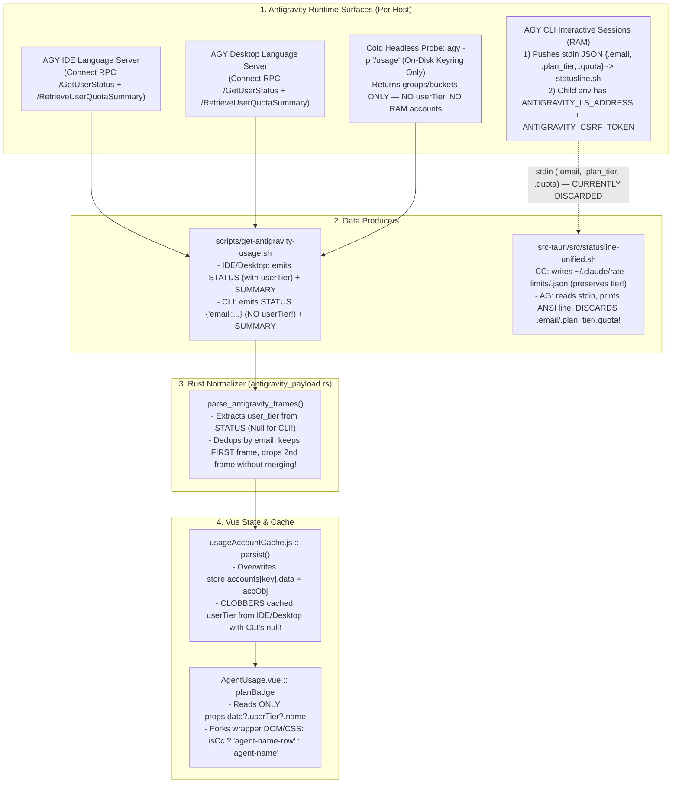

# Antigravity Plan Badge Inconsistency & Systemic Rule Violations Audit

Status: amended 2026-10-28

## 1. Start time

2026-10-28 (audited against `v1.36.0`, commit `6c30560`)

## 2. Initial purpose

Investigate the deep root causes of why Antigravity (`AGY`) plan/tier badges (`Pro`, `Starter`, `Ultra`, etc.) fail to display consistently in the header (`[icon] -> [title] -> [plan badge] -> [account list]`) compared to Claude Code (`CC`), and diagnose why this subsystem violated multiple `akirule` laws (`flow`, `pattern`, `coding`, `ui`, `test`, `docs`) and project-level invariants (`CLAUDE.md` multi-entity regression guard, historical statusline/cache lessons).

## 3. Strategy

1. **End-to-End Flow Trace (`METHOD-audit-flow.md` §B1–B8):** Trace `userTier` / `plan_tier` from all three Antigravity runtime surfaces (IDE Language Server, Desktop App Language Server, `agy` CLI) through `scripts/get-antigravity-usage.sh`, `src-tauri/src/statusline-unified.sh`, `src-tauri/src/agent_usage/antigravity_payload.rs`, `src/composables/usageMonitor.js`, `src/composables/usageAccountCache.js`, `src/components/AgentUsageSlot.vue`, and `src/components/AgentUsage.vue`.
2. **Git Archaeology (`coding.B2` Chesterton's Fence):** Inspect the commit sequence `51e7906` (*read the agy CLI quota through agy's own headless /usage*), `6cde17c` (*keep each Claude Code account's quota separate*), `15c7929` (*route Antigravity Argon 4 quota*), and `733931c` (*compact 3-pool quota bars*) to see how each localized patch broke upstream/downstream invariants.
3. **Live Runtime Probe (`coding.B3` Ladder Rung 5):** Execute `scripts/get-antigravity-usage.sh`, `agy -p "/usage" --output-format json`, Connect RPC `/GetUserStatus` against live Language Server ports, and inspect `state.vscdb` and `~/.gemini/antigravity-cli/cli.log` on macOS with multiple concurrent `agy` sessions (`lacvietanh@gmail.com` on Pro, `nxkxb294@gmail.com` on Free/Starter).
4. **Docs-vs-Reality Walk (`RULE-docs.md` §C3–C4):** Cross-check `docs/arch/usage-antigravity.md`, `docs/arch/usage-claudecode.md`, `docs/ref/statusline-unified-spec.md`, `docs/ref/antigravity-multi-account-ram-credentials.md`, and `docs/plan/done/1.16.1-ag-usage.md` / `1.17.0-ag-multi-surface.md` against current code.
5. **First-Principles & Adversarial Critique (`METHOD-deep-think.md` §B1–B5):** Evaluate candidate fixes so the redesign heals the flow by construction rather than adding another patch.

## 4. Checklist

- [x] Read `src/components/AgentUsage.vue`, `src/components/AgentUsageSlot.vue`, `src/composables/usageAccountCache.js`, `src/composables/usageMonitor.js`
- [x] Read `src-tauri/src/agent_usage/antigravity.rs`, `src-tauri/src/agent_usage/antigravity_payload.rs`, `scripts/get-antigravity-usage.sh`, `src-tauri/src/statusline-unified.sh`
- [x] Inspect git blame and commit diffs (`51e7906`, `6cde17c`, `15c7929`, `733931c`)
- [x] Run live probes against `agy -p "/usage"`, `GetUserStatus` RPC, `state.vscdb`, and `cli.log`
- [x] Audit `docs/arch/usage-antigravity.md` and related docs under `docs.C3` / `docs.C4`
- [x] Run `METHOD-deep-think.md` critique pass on the unified architecture design
- [x] Synthesize execution plan in `docs/plan/done/ag-plan-badge-unification.md`

---

## 5. Result

### 5.1. Executive Summary — 6 Root Causes (Technical & Structural)

**Conclusion:** The missing/inconsistent Antigravity plan badge is not a single UI typo; it is the visible symptom of **6 compounding defects** where producer schema asymmetry, destructive full-object cache overwrites, single-frame deduplication loss, unused statusline stdin telemetry, a mocked-wrong unit test fixture, and a half-merged Vue template/CSS fork all reinforced each other.

| ID | Layer | Concrete Defect (`file:line`) | User-Visible Impact | Primary Rules Violated |
|---|---|---|---|---|
| **RC-1** | Producer (`scripts/get-antigravity-usage.sh:262-290` & `antigravity_payload.rs:47-66, 213-240`) | In commit `51e7906`, the `agy` CLI probe was replaced with `agy -p "/usage" --output-format json`. `/usage` returns only quota buckets (`command.data.groups`), and `get-antigravity-usage.sh:287` hardcodes `|||STATUS|||{"email":"%s"}` with **no `userTier`**. `antigravity_payload.rs:58` then sets `user_tier = Value::Null`. | Any account monitored via `agy` CLI (`sourceType: 'cli'`) has `userTier: null` and **never displays a plan badge**. | `coding.B2` (Chesterton's Fence / after-change invariant check), `flow.B5` |
| **RC-2** | Persistence (`src/composables/usageAccountCache.js:112-114`) | `persist(payload, host)` executes `store.accounts[key] = { email, sourceType, fetchedAt: now, data: accObj }` — a **blind full-object overwrite** instead of preserving non-null metadata (`userTier`) from `prev.data`. | If an account was previously seen via IDE/Desktop RPC with `"userTier": {"name": "Google AI Pro"}`, a single subsequent `agy` CLI poll **clobbers `store.accounts[key].data.userTier` with `null`**, erasing the plan badge even from the offline cache! | `pattern.A8`, `flow.B4`, `CLAUDE.md` Regression Guard (multi-entity state clobber), History lesson (`statusline-unified.sh:58-82`) |
| **RC-3** | Aggregator (`src-tauri/src/agent_usage/antigravity_payload.rs:68-72`) | When multiple frames share the same `email` (e.g. Desktop/IDE RPC frame + CLI frame), `parse_antigravity_frames` deduplicates via `if !seen_instance_keys.contains(&instance_key)` — keeping the **first** frame and throwing away the rest without merging fields (`userTier`, `sourceType`). | If a frame lacking `userTier` (or carrying partial metadata) is processed first, or when both IDE/Desktop and CLI run for the same account, metadata from the second surface is silently discarded. | `flow.B3`, `flow.B5` (state dropped at transition boundary) |
| **RC-4** | Passive Hook vs Active Poll (`src-tauri/src/statusline-unified.sh:24-177`, `scripts/get-antigravity-usage.sh:262-290`) | `agy` CLI sends the **exact per-session in-RAM payload** to `~/.gemini/antigravity-cli/statusline.sh` on `stdin` every turn — including `.email`, `.plan_tier` (`"Google AI Pro"`), and `.quota` (`docs/ref/statusline-unified-spec.md:324, 373`). Yet `statusline-unified.sh` only caches stdin payloads for `CLI="CC"` (`aki-rlcache`), throwing away `AG`'s `.plan_tier` and `.quota`! Meanwhile, `get-antigravity-usage.sh` spawns a 4–7s, 200MB cold `agy -p "/usage"` process that only sees the **single on-disk keyring account** and misses all other in-RAM `agy` sessions AND their `plan_tier`. | 1) `plan_tier` is never captured from `agy` CLI even though `agy` pushes it to `statusline.sh` on every turn. 2) Concurrent `agy` CLI sessions running different accounts in RAM (`docs/ref/antigravity-multi-account-ram-credentials.md`) are invisible to `agy -p "/usage"`. | `pattern.A1` (SSoT), `pattern.B2` (Reuse existing pattern), `coding.C3` (Performance), `flow.B6` (Native flow) |
| **RC-5** | Consumer Contract vs Test (`src/components/AgentUsage.vue:668-670` vs `antigravity_payload.rs:398`) | `AgentUsage.vue:670` only reads `props.data?.userTier?.name` (assuming an object `{ name: string }`). It ignores `userTier` when it is a plain string, ignores `plan_tier` / `planStatus.planInfo.planName`, and ignores `userTier.id`. Meanwhile, `antigravity_payload.rs:398` unit test fixtures `"userTier": "PRO"` (a string!) — a shape that `AgentUsage.vue:670` renders as `""` (empty)! | Schema drift between Rust test fixtures, CLI strings (`"Google AI Pro"`), and IDE RPC objects (`{"id": "g1-pro-tier", "name": "Google AI Pro"}`) causes silent badge disappearance. | `test.C` / `coding.B3` (test fixture diverges from consumer), `coding.C1` (boundary normalization) |
| **RC-6** | UI Header DOM & CSS Fork (`src/components/AgentUsage.vue:4, 15, 31-35, 61, 306-311, 697-753`) | Commit `6cde17c` merged the CC and AG header templates halfway, leaving `:class="isCc ? 'agent-name-row' : 'agent-name'"` on the wrapper `<div>` and `:class="{ 'claudecode-custom-header': isCc }"` on `.agent-header`. For CC, `.agent-name-row` is a flex row (`gap: 6px; flex: 1; min-width: 0`) and `.agent-name` styles only the title text. For AG, `.agent-name` (`font-size: 12px; font-weight: 700; gap: 4px`, no `flex: 1`) is applied to the **entire outer container** holding `[title] + [planBadge] + [account list] + [eye button]`. Also leaves dead `desktop_cli` branches (`lines 15, 61`) that no backend emits. | Inconsistent spacing, flex truncation, and typography between AG and CC headers (`[icon] -> [plan] -> [account list]`), plus dead code branches in `AgentUsage.vue`. | `pattern.A5`, `pattern.A8`, `ui.A1`, `ui.B3`, `coding.B4` |

---

### 5.2. Flow Audit (`METHOD-audit-flow.md` §C3)



1. **Flow target:** End-to-end acquisition, normalization, caching, and header rendering of Antigravity account identity, plan tier (`userTier`), and quota across IDE, Desktop, and CLI surfaces into `[icon] -> [title] -> [plan badge] -> [account list]`.
2. **Intended flow:** Regardless of whether an Antigravity account is active in the IDE, Desktop app, or `agy` CLI (or viewed offline from `usageAccountCache`), its normalized payload carries `userTier` (`Pro`, `Starter`, `Ultra`, etc.), merges cleanly across surfaces without losing fields, and renders in the exact same header structure as Claude Code.
3. **Actual flow:**
   - IDE/Desktop RPC (`GetUserStatus`) returns `userStatus.userTier: { id: "g1-pro-tier", name: "Google AI Pro" }` and `userStatus.planStatus.planInfo.planName: "Pro"`.
   - `agy -p "/usage"` returns only quota buckets; `get-antigravity-usage.sh:287` fabricates `{"email":"..."}` with no `userTier`.
   - `statusline-unified.sh` receives `"plan_tier": "Google AI Pro"` on `stdin` from every interactive `agy` turn (`docs/ref/statusline-unified-spec.md:324`), but neither persists it nor shares it with the usage probe.
   - `antigravity_payload.rs` sets `userTier: null` on CLI frames and drops duplicate-email frames instead of merging non-null fields.
   - `usageAccountCache.persist()` overwrites the entire cached account object for `(host, email)`, destroying any previously cached `userTier` when a CLI frame arrives.
   - `AgentUsage.vue` renders `props.data?.userTier?.name` inside a forked `isCc ? 'agent-name-row' : 'agent-name'` wrapper.
4. **Breakpoints:**
   - **B-1 (Producer breakpoint):** `get-antigravity-usage.sh:287` emits `{"email":"%s"}` without `userTier`.
   - **B-2 (Multi-session RAM breakpoint):** `agy -p "/usage"` cold-starts from disk credentials, missing concurrent in-RAM `agy` sessions authenticated under other accounts (`docs/ref/antigravity-multi-account-ram-credentials.md` §2).
   - **B-3 (Aggregator breakpoint):** `antigravity_payload.rs:68-72` first-frame-wins dedup discards `userTier` if a CLI frame or partial frame precedes an RPC frame.
   - **B-4 (Cache clobber breakpoint):** `usageAccountCache.js:112-114` overwrites `prev.data.userTier` with `null`.
   - **B-5 (Schema/UI breakpoint):** `AgentUsage.vue:670` requires `userTier` to be `{ name: string }` and forks header DOM/CSS classes by `isCc`.
5. **Artificial enforcement:**
   - Forked template classes (`isCc ? 'agent-name-row' : 'agent-name'`, `:class="{ 'claudecode-custom-header': isCc }"`) and dead `desktop_cli` icon branches (`AgentUsage.vue:15, 61`) trying to special-case AG vs CC instead of feeding one normalized header contract.
6. **Root shape problems:**
   - **Asymmetric producer contract:** CC has a single Per-Account Cache writer (`statusline-unified.sh` `aki-rlcache` v6) that explicitly preserves `rate_limit_tier` across turns (`[ -z "$_rl_tier" ] && _rl_tier=$(jq -r '.rate_limit_tier // ""' "$RLCACHE")`), whereas AGY split its producers (`GetUserStatus` RPC vs `agy -p "/usage"`) without normalizing or preserving `userTier`.
   - **Whole-object replacement on partial updates:** `usageAccountCache.persist()` treats every incoming snapshot as complete, violating monotonic metadata preservation.
   - **Backend leaks raw provider shapes to Vue:** `antigravity_payload.rs` passes raw `userTier` (object from RPC, `null` from CLI, string in unit tests) straight to Vue instead of normalizing at the Rust boundary (`pattern.A6`, `coding.C1`).
7. **Native-flow redesign:**
   - **At the statusline boundary (`src-tauri/src/statusline-unified.sh`):** When `CLI="AG"` and `$input` has `.email` + (`.plan_tier` or `.quota`), write a lightweight per-account statusline cache `~/.gemini/antigravity-cli/usage-cache/<email>.json` (same pattern as CC's `~/.claude/rate-limits/<email>.json`), capturing `email`, `plan_tier`, `quota`, and `updated_at` directly from the live in-RAM session at zero extra process cost.
   - **At the probe boundary (`scripts/get-antigravity-usage.sh`):** Resolve `userTier` for CLI accounts from `~/.gemini/antigravity-cli/usage-cache/<email>.json` (or `state.vscdb` / cached tier) and emit per-account CLI frames so both `plan_tier` and multi-account RAM sessions are preserved.
   - **At the Rust boundary (`src-tauri/src/agent_usage/antigravity_payload.rs`):** Normalize `userTier` into a canonical `{ "name": "<clean tier>" }` (accepting `{ name }`, string `"Google AI Pro"` / `"PRO"`, `plan_tier`, or `planStatus.planInfo.planName`), and when deduplicating multiple frames for the same `email`, **merge** non-null `userTier` and `quotaSummary` rather than dropping the second frame.
   - **At the frontend cache boundary (`src/composables/usageAccountCache.js`):** In `persist()`, if `accObj.userTier == null && prev?.data?.userTier != null`, preserve `prev.data.userTier` (and likewise for CC `rate_limit_tier` / `subscription_type` if absent).
   - **At the Vue component boundary (`src/components/AgentUsage.vue`):** Unify the header DOM into one shared `.agent-name-row` structure (`[icon] -> [displayName (u-narrow-hide)] -> [planBadge] -> [account trigger + menu] -> [eye button] -> [org]`), delete the `isCc ? 'agent-name-row' : 'agent-name'` fork and dead `desktop_cli` branches, and optionally show each account's plan badge inside the account dropdown menu for instant multi-account clarity.
8. **Fastest validation:**
   - Unit tests in `antigravity_payload.rs` testing: (a) object `userTier`, string `userTier`, and `planStatus.planInfo.planName` normalization; (b) same-email frame merge where Frame 1 has `userTier: null` (CLI) and Frame 2 has `userTier: { name: "Google AI Pro" }` (IDE/Desktop) and vice versa.
   - Unit test in `test/` for `usageAccountCache.persist()` verifying that a subsequent snapshot with `userTier: null` preserves the previously cached `userTier` for the same `(host, email)`.
   - Live run of `bash scripts/get-antigravity-usage.sh` on macOS confirming `userTier` is populated for `cli` frames.

---

### 5.3. Deep Audit of `akirule` & Project Criteria Violations

#### A. Why `coding.B2` (Changing Existing Code / Chesterton's Fence) Was Violated in `51e7906`
- `coding.B2` mandates:
  - **Before:** grasp the flow and intent of the code before you change it.
  - **After:** confirm the intents and flows you did NOT set out to touch still hold — a fix scoped to problem X must not silently break an unrelated property Y.
- In commit `51e7906` (`fix(usage): read the agy CLI quota through agy's own headless /usage`), the author focused exclusively on problem X (*"agy 1.4.x RPC returns 401 because `--csrf_token` is no longer in argv"*).
- The old CLI RPC path called **two** endpoints: `GetUserStatus` (which supplied `email` AND `userTier`) + `RetrieveUserQuotaSummary` (which supplied quota buckets).
- The replacement `agy_cli_frame()` replaced `RetrieveUserQuotaSummary` with `agy -p "/usage"` and extracted `email` from `--log-file`, emitting `|||STATUS|||{"email":"%s"}` — **silently dropping `userTier` (property Y)** without checking all consumers of `STATUS` (`antigravity_payload.rs:58` -> `AgentUsage.vue:670` `planBadge`).

#### B. Why `CLAUDE.md` Regression Guard & Historical Lessons Were Violated (`usageAccountCache.js`)
- `CLAUDE.md` explicitly warns:
  > **Regression guard**: `AgentUsage.vue`, `useSsh.js`, `statusline.rs`, `ClaudeSettingModal.vue`, and `usage.rs` are shared multi-entity modules — check all callers before editing.
- Furthermore, in `src-tauri/src/statusline-unified.sh:58-82` (and `docs/arch/usage-claudecode.md` §1), this project **already solved** the exact "partial source overwrites cached tier" bug for Claude Code:
  ```sh
  # The plan tier is only in .claude.json, which every account in the dir overwrites: trust it only while it names this account, else keep the tier cached before.
  [ -z "$_rl_tier" ] && _rl_tier=$(jq -r '.rate_limit_tier // ""' "$RLCACHE" 2>/dev/null)
  ```
- Yet `src/composables/usageAccountCache.js:112-114` ignored that exact project history lesson (`pattern.B2` Reuse) and wrote:
  ```js
  store.accounts[key] = {
    email: accObj.email, sourceType, fetchedAt: now, data: accObj,
  };
  ```
  When `accObj` comes from a CLI poll (`userTier: null`), it blindly overwrites `prev.data` from an earlier IDE/Desktop poll (`userTier: { name: "Google AI Pro" }`), destroying known state for the same `(host, email)` entity.

#### C. Why `test.C` & `coding.B3` (Verification & Test Truthfulness) Were Violated (`antigravity_payload.rs:398`)
- `coding.B3` / `test.C` states: *"A test result is evidence only for what that test exercised and could have failed on."*
- In `src-tauri/src/agent_usage/antigravity_payload.rs:398`, `test_parse_antigravity_frames_single` passes:
  ```rust
  |||STATUS|||{"userStatus":{"email":"a@b.com","userTier":"PRO","cascadeModelConfigData":{"clientModelConfigs":[]}}}
  ```
  and asserts `res["userTier"] == "PRO"` (a JSON **string**).
- Meanwhile, the actual Connect RPC `GetUserStatus` returns an **object** (`"userTier": {"id": "g1-pro-tier", "name": "Google AI Pro"}`), and `AgentUsage.vue:670` reads `props.data?.userTier?.name`!
- Because the Rust unit test asserted on a fabricated string shape (`"PRO"`) that would actually **fail to render** in `AgentUsage.vue:670` (`"PRO".name === undefined`), the test gave false confidence while masking the contract mismatch between Rust and Vue.

#### D. Why `pattern.A5`, `pattern.A8`, `ui.A1`, `ui.B3`, and `coding.B4` Were Violated (`AgentUsage.vue`)
- **Incomplete template unification (`6cde17c`):** When `6cde17c` unified the CC and AG headers in `AgentUsage.vue:4-95`, it kept two parallel layout regimes via ternary class switches:
  - Line 4: `<div class="agent-header" :class="{ 'claudecode-custom-header': isCc }">`
  - Line 31: `<div :class="isCc ? 'agent-name-row' : 'agent-name'">`
  - Line 32: `<span :class="isCc ? 'agent-name u-narrow-hide' : 'u-narrow-hide'">{{ displayName }}</span>`
- **Consequence of the CSS fork (`AgentUsage.vue:697-736`):**
  - `.agent-name-row` (used only when `isCc === true`) has `display: flex; align-items: center; gap: 6px; min-width: 0; flex: 1; flex-wrap: nowrap;`.
  - `.agent-name` (used on the parent wrapper when `isCc === false`, and on the inner title `<span>` when `isCc === true`) has `font-size: 12px; font-weight: 700; color: var(--text-main); white-space: nowrap; display: flex; align-items: center; gap: 4px;`.
  - Putting `.agent-name` on the parent wrapper for AG violates `pattern.A3` (one class doing two jobs: text typography for CC's title span vs flex row container for AG's entire header content) and `pattern.A8` (one natural flow for both agents).
- **Dead `desktop_cli` code (`coding.B4` / `pattern.B3`):**
  - `AgentUsage.vue:15` (`v-else-if="currentSourceType === 'desktop' || currentSourceType === 'desktop_cli'"`) and `AgentUsage.vue:61` (`v-else-if="acc.sourceType === 'desktop' || acc.sourceType === 'desktop_cli'"`) check for `'desktop_cli'`.
  - Grep across `src-tauri/` and `scripts/` confirms `'desktop_cli'` is **never emitted anywhere** in the backend (`get-antigravity-usage.sh` emits only `ide`, `desktop`, `cli`; `antigravity_payload.rs` never synthesizes `desktop_cli`).

#### E. Why `RULE-docs.md` (`docs.A4`, `docs.B3`, `docs.C3`, `docs.C4`) Was Violated — Docs Drift Audit
Walking the documentation topology against the live `1.36.0` codebase (`6c30560`) reveals **8 concrete drift findings** across 4 severity levels (`docs.C4`):
- **Count by severity:** **2 Wrong** · **3 Stale** · **2 Incomplete** · **1 Cosmetic**

| # | Severity (`docs.C4`) | File & Location | What the Doc Claims | What Reality Is (`v1.36.0`) | Rule Violated |
|---|---|---|---|---|---|
| **D-1** | **Wrong** | `docs/arch/usage-antigravity.md:139, 167` | *"Contrast with Claude Code: CC deliberately has no multi-account cache... DESIGN LOCK: CC has no multi-account cache"* — stamped `> updated 2026-10-26 · v1.34.0` at line 3! | Shipped in **v1.34.0** (`6cde17c`, `CHANGELOG.md:39`, `docs/arch/usage-claudecode.md` §1, `usageAccountCache.js:7-10`): CC shares `usageAccountCache.js` (`aki-claudecode-usage-cache-v1`) with the exact same dropdown & cache mechanics! Even worse, the anchor stamp on `usage-antigravity.md` was bumped to `v1.34.0` without verifying the body (`docs.A4`: *"A stamp older/falsely certifying content nobody checked is worse than no stamp"*). | `docs.A4`, `docs.B3`, `docs.C3` |
| **D-2** | **Wrong** | `docs/arch/usage-antigravity.md:107-110` | Claims `get_antigravity_usage` is compiled into the Tauri binary via `include_str!` inside `antigravity.rs`. | `include_str!("../../scripts/get-antigravity-usage.sh")` lives in `src-tauri/src/agent_usage/mod.rs:34`, not `antigravity.rs`. | `docs.B3`, `docs.C3` |
| **D-3** | **Stale** | `docs/arch/usage-antigravity.md:94-103` | Section `"4. Data Shape & Frontend Adaptation (AgentUsage.vue)"` describes `quotaSummary.groups` as a 2-pool radial/bar model (`Gemini` + `Claude/GPT`) and omits the 3-pool Argon 4 architecture (`Gemini` / `Argon 4` / `Claude · GPT`) shipped in `1.34.0` (`15c7929`, `733931c`). | `AgentUsage.vue` renders 3 fixed pools (`Gemini`, `Argon 4`, `Claude · GPT`) with 5h/7d dual linear bars and elapsed-window markers (`6c30560`). | `docs.B3`, `docs.C3` |
| **D-4** | **Stale** | `docs/ref/antigravity-multi-account-ram-credentials.md:65` | States: *"When desktop and CLI agree, the account appears once, with the desktop icon (its frame comes first in the per-email dedup of `antigravity_payload.rs`)."* | Fails to note that if only `cli` runs (or if `cli` updates the cache after `desktop` quits), `cli` emits no `userTier` and overwrites the cached `desktop` entry's `userTier` with `null`. | `docs.B3`, `docs.C3` |
| **D-5** | **Stale** | `docs/plan/done/1.16.1-ag-usage.md` & `docs/plan/done/1.17.0-ag-multi-surface.md` | Specify wide-mode header labels `agy` / `AG IDE` / `AG / AGY` and `sourceType: "desktop_cli"`. | Code (`AgentUsage.vue:306-311`) renders `CLI` / `IDE` / `AG`, and `desktop_cli` was never implemented in `get-antigravity-usage.sh` or `antigravity_payload.rs` (only dead branches remain in `AgentUsage.vue:15, 61`). | `docs.B3`, `docs.C3` |
| **D-6** | **Incomplete** | `docs/arch/usage-antigravity.md:88-91` (`§3 Output Mapping`) | Lists only `email`, `models`, and `quotaSummary` in the standardized JSON snapshot. | Completely omits `userTier`, `sourceType`, and `allAccounts` from the documented output schema, which is why `51e7906` modified `usage-antigravity.md` §1b without realizing `userTier` was part of the required output contract! | `docs.C3`, `docs.C4` |
| **D-7** | **Incomplete** | `docs/ref/statusline-unified-spec.md:18-26` | Documents `.cwd`, `.model`, `.effort`, `.context_window`, `.account.email` in the stdin mapping table, while `.plan_tier` appears only in the raw AGY 1.1.5 fixtures (§8.5 line 324, §8.6 line 373) with no extraction rule or cache role. | `.plan_tier` is sent by `agy` CLI on stdin (`json:"plan_tier,omitempty"` verified in `agy` 1.4.8 binary) but is unmapped and discarded by `statusline-unified.sh`. | `docs.C3`, `docs.C4` |
| **D-8** | **Cosmetic** | `docs/index.md:95` | Lists `[docs/plan/done/agy-argon4-quota-bars.md](plan/done/agy-argon4-quota-bars.md)` under `## Plans (Active)`. | The file is already in `docs/plan/done/` and shipped in `1.34.0`; it belongs under `## Plans (Completed)` (`docs.B1`). | `docs.A1`, `docs.B1` |

---

### 5.4. Deep-Think Analysis & Critique (`METHOD-deep-think.md` §B1–B5)

#### Module 1 — Goal Excavation (`think.B1`)
- **Immediate goal:** Make Antigravity's plan badge (`Pro`, `Starter`, `Ultra`, etc.) display consistently across all surfaces (IDE, Desktop, CLI, and cached accounts) in the exact `[icon] -> [title] -> [plan badge] -> [account list]` sequence as Claude Code.
- **Intermediate goal:** Ensure every Antigravity account's `userTier` is reliably acquired, normalized into one canonical shape at the Rust boundary, and preserved across partial/multi-surface polls without clobbering.
- **Ultimate goal:** Instant, trustworthy multi-account situational awareness at a glance — the user knows which account and which subscription tier (`Pro` vs `Starter` vs `Ultra`) is active or pinned in each slot without false disappearances or visual jitter.

#### Module 2 — First Principles (`think.B2`)
- **Verified Facts (distilled into [docs/ref/fact-antigravity-quota-tiers.md](../ref/fact-antigravity-quota-tiers.md)):**
  1. Connect RPC `/GetUserStatus` (available on Antigravity IDE and Antigravity Desktop language servers) returns both:
     - `userStatus.userTier`: `{"id": "g1-pro-tier", "name": "Google AI Pro", "description": "Google AI Pro", ...}`
     - `userStatus.planStatus.planInfo.planName`: `"Pro"` (and `teamsTier: "TEAMS_TIER_PRO"`).
  2. `agy` CLI (`1.4.8`) in headless print mode (`agy -p "/usage" --output-format json`) does **not** include `userTier` or `plan_tier` in its JSON output or `--log-file`, and `agy -p "/credits" --output-format json` returns only `{"remaining_credits": 0, "upgrade_uri": "https://antigravity.google/g1-upgrade"}`.
  3. **New Vendor Fact (2026-10-28) — Antigravity Free tier is now Weekly-only:**
     - Live probe of Free account `nxkxb294@gmail.com` via `agy -p "/usage" --output-format json` (`agy 1.4.8`) vs Pro account `lacvietanh@gmail.com` via `RetrieveUserQuotaSummary` proves that Google removed the 5-hour sliding limit from the Free tier:
       - **Free tier (`nxkxb294@gmail.com`):** Emits **only** `gemini-weekly` and `3p-weekly` (zero `5h` buckets, no `Gemini 4 Argon` group), with global description `"Within each group, models share a weekly limit... Your weekly limit is tied directly to your individual tier."`
       - **Pro tier (`lacvietanh@gmail.com`):** Emits `gemini-5h` + `gemini-weekly`, `3p-5h` + `3p-weekly`, **plus** a separate `Gemini 4 Argon` group (`gemini-argon-wtu-weekly`), with global description `"Within each group, models share a weekly limit and a 5-hour limit..."`
       - **Ultra tier:** Emits `5h` + `weekly` buckets with Argon pooled inside `Gemini Models` (`"For paid Pro plans, Argon quota is separate. Higher Argon quota (included as part of the larger Gemini quota bucket) is available on Ultra plans."`).
     - **Immediate architectural consequence:** Even on a cold `agy -p "/usage"` CLI poll where neither `GetUserStatus` nor `statusline.sh` has cached a tier yet, `antigravity_payload.rs` can deterministically infer `"Free"` when all buckets are `window == "weekly"` (no `5h` bucket in `Gemini Models` or `Claude and GPT models`), and `"Pro"` when `5h` buckets exist alongside a separate `Gemini 4 Argon` group!
  4. In addition, `agy` CLI exposes the explicit tier string in two places:
     - **Interactive `statusline.sh` stdin payload:** `agy` passes `{"email": "...", "plan_tier": "Google AI Pro", "quota": {...}}` (`json:"plan_tier,omitempty"`, verified in `agy` 1.4.8 binary and `docs/ref/statusline-unified-spec.md:324`).
     - **Local IDE/Desktop SQLite & cache:** On a machine where the account has signed into Antigravity IDE (`state.vscdb` key `antigravityAuthStatus` -> `userStatusProtoBinaryBase64` contains the serialized proto with `email` and tier `Pro`), or where IDE/Desktop was previously polled (`usageAccountCache`), the tier is already known.
  5. When an account is polled via `agy -p "/usage"` (`sourceType: "cli"`), explicit `userTier` is absent from that single probe response, which is a **partial reading** (has fresh quota buckets, lacks explicit tier metadata) — identical in structure to a Claude Code turn that has `.rate_limits` without `.claude.json` matching that account.

#### Module 3 — Mandatory Adversarial Critique (`think.B3`)
- **Option 1 (Rejected): Only fix `usageAccountCache.persist()` in Vue to keep `prev.data.userTier` when incoming `userTier` is null.**
  - *Steelman Option 1:* 3 lines of JS; zero shell or Rust changes; immediately stops CLI polls from wiping out an IDE/Desktop-cached tier.
  - *Attack Option 1:* Fails completely on any host (like a headless SSH Linux box or a CLI-only account `nxkxb294@gmail.com`) where the user **only** runs `agy` CLI and never opens the Antigravity IDE/Desktop GUI! Also fails when both IDE and CLI are running on the same email and `antigravity_payload.rs` deduplicates frames before Vue ever sees the second frame.
- **Option 2 (Favored): Multi-layer Native Flow Unification (Statusline cache + Rust normalization/merge + Frontend cache field preservation + Unified Vue header).**
  1. **Statusline cache (`statusline-unified.sh`):** Extend `statusline-unified.sh` so that when `CLI="AG"`, it writes `~/.gemini/antigravity-cli/usage-cache/<sanitized_email>.json` containing `{email, plan_tier, quota, seen_at}` whenever `input` carries `.email` (preserving previous `plan_tier` if a turn omits it, just like `aki-rlcache` does for CC!).
  2. **Probe enrichment (`scripts/get-antigravity-usage.sh`):** When emitting the `cli` frame (from `agy -p "/usage"` and/or recent `~/.gemini/antigravity-cli/usage-cache/*.json` for live `agy` processes), inject `"userTier": {"name": "<plan_tier>"}` from the per-account cache file when available.
  3. **Rust normalization & frame merge (`antigravity_payload.rs`):**
     - Normalize `userTier` via a dedicated helper `extract_user_tier(status_json)` that accepts `{ name: "..." }`, plain string `"..."`, `plan_tier`, or `planStatus.planInfo.planName`, always emitting `{"name": "<cleaned>"}` or `Value::Null`.
     - In `parse_antigravity_frames`, when a second frame arrives for an already-seen `email`, **merge** missing `userTier` (and prefer richer `quotaSummary`) into the existing account entry instead of discarding the frame!
  4. **Frontend cache preservation (`usageAccountCache.js`):** In `persist()`, merge `userTier` (for AG) and `rate_limit_tier` / `subscription_type` (for CC) from `prev?.data` whenever the new reading has `null`/`""` for those fields.
  5. **Vue Header & Dropdown Unification (`AgentUsage.vue`):** Replace the `isCc ? 'agent-name-row' : 'agent-name'` fork with one unified `.agent-name-row` structure (`[icon] -> [title] -> [plan badge] -> [account list] -> [eye]`), remove dead `desktop_cli` checks, and render each account's cached tier badge inside the account dropdown list as well.
  - *Attack on Option 2:* What if `statusline-unified.sh` hasn't been re-applied on a remote host yet?
    - *Mitigation:* `statusline.rs` already has `OUTDATED_AT_VERSION` auto-upgrade on app startup (`docs/research/statusline-hook-upgrade.md`), AND Layers 3 + 4 (Rust frame merge + `usageAccountCache.persist` preservation) work immediately without waiting for statusline execution.
  - *Inversion ("How could this still fail?"):*
    - If `statusline-unified.sh` on AGY spawned an external process (like `agy`) on every turn, it would add 4s latency to the terminal prompt. **Rule:** The AGY block in `statusline-unified.sh` must be **pure stdin JSON extraction** (1 `jq` call on `$input`, zero subprocesses, <10ms).
    - Look at `statusline-unified.sh:35` (discovered in Turn 1 on SSH Linux host `bien`): `stat -f %m` succeeds on GNU `stat` (printing filesystem info instead of mtime) and breaks bash arithmetic! Any mtime check or file write in `statusline-unified.sh` must use `jq`'s `now` or check `OSTYPE` before `stat`.
  - *Pre-mortem (6 months later):* Someone changes `userTier` format again in a future Antigravity release. Because `extract_user_tier()` in `antigravity_payload.rs` is now the single normalizer (checking `userTier.name`, string `userTier`, `plan_tier`, and `planStatus.planInfo.planName`) and strips `Google`/`AI` once, `AgentUsage.vue` never has to guess raw vendor shapes again.
  - *Second-order effects:* Adding `aki-agcache` to `statusline-unified.sh` also solves the multi-account RAM blindness of `agy -p "/usage"` (`docs/ref/antigravity-multi-account-ram-credentials.md`): when two `agy` terminals run Account A and Account B in RAM, each terminal's `statusline.sh` receives its own in-RAM `.email`, `.plan_tier`, and `.quota` on `stdin` and writes its own `<email>.json`!

---

### 5.5. Verification & Corroborating Links

#### Verification (`coding.B3`)
- **Live RPC Verification (macOS, `v1.36.0`):** Queried live `agy` Language Server (`http://localhost:65053/exa.language_server_pb.LanguageServerService/GetUserStatus`), confirming exact response schema:
  ```json
  {
    "email": "lacvietanh@gmail.com",
    "userTier": {
      "id": "g1-pro-tier",
      "name": "Google AI Pro",
      "description": "Google AI Pro"
    },
    "planInfo": {
      "teamsTier": "TEAMS_TIER_PRO",
      "planName": "Pro"
    }
  }
  ```
- **Live Probe Verification (macOS, `v1.36.0`):** Ran `bash scripts/get-antigravity-usage.sh`, confirming that for `agy-cli` it outputs `|||STATUS|||{"email":"nxkxb294@gmail.com"}` with no `userTier`, and misses `lacvietanh@gmail.com` despite PIDs `26537` and `25083` actively running `agy` under `lacvietanh@gmail.com`.
- **Binary Verification (`agy 1.4.8`):** Confirmed via `strings ~/.local/bin/agy` that `StatusLine` struct serializes `PlanTier` as `json:"plan_tier,omitempty"`.
- **Static Code Verification:** Verified all 6 root causes with exact `file:line` citations in `scripts/get-antigravity-usage.sh`, `src-tauri/src/statusline-unified.sh`, `src-tauri/src/agent_usage/antigravity_payload.rs`, `src/composables/usageAccountCache.js`, and `src/components/AgentUsage.vue`.

#### Corroborating Links
- [AgentUsage.vue](../../src/components/AgentUsage.vue#L1-L95) — Header template and `isCc` DOM/CSS fork
- [AgentUsage.vue (`planBadge`)](../../src/components/AgentUsage.vue#L668-L670) — `props.data?.userTier?.name` consumer
- [usageAccountCache.js](../../src/composables/usageAccountCache.js#L93-L120) — `persist()` full-object overwrite
- [antigravity_payload.rs](../../src-tauri/src/agent_usage/antigravity_payload.rs#L47-L87) — `user_tier` extraction and first-frame-wins deduplication
- [get-antigravity-usage.sh](../../scripts/get-antigravity-usage.sh#L262-L290) — `agy_cli_frame()` emitting `{"email":"%s"}` without `userTier`
- [statusline-unified.sh](../../src-tauri/src/statusline-unified.sh#L23-L177) — CC-only `aki-rlcache` vs uncached AGY stdin payload
- [usage-antigravity.md](../../docs/arch/usage-antigravity.md) — Architecture doc with `Wrong` / `Stale` / `Incomplete` drift findings

---

## 6. Decision

- **Action:**
  - Execute the 5-step remediation plan in [docs/plan/done/ag-plan-badge-unification.md](../plan/done/ag-plan-badge-unification.md).
  - Materialize the verified Free/Pro/Ultra quota bucket & tier facts into [docs/ref/fact-antigravity-quota-tiers.md](../ref/fact-antigravity-quota-tiers.md) (`docs.A6`).
- **No action:**
  - *Synthesizing `desktop_cli` combined icon state:* Rejected (`pattern.B3` Subtract before you share). `1.17.0-ag-multi-surface.md` imagined a `desktop_cli` combined sourceType that was never implemented in any producer; deleting the two dead `desktop_cli` checks in `AgentUsage.vue:15, 61` is cleaner than adding cross-surface icon synthesis.
- **Cross-references:**
  - [docs/plan/done/ag-plan-badge-unification.md](../plan/done/ag-plan-badge-unification.md)
  - [docs/ref/fact-antigravity-quota-tiers.md](../ref/fact-antigravity-quota-tiers.md)
  - [docs/arch/usage-antigravity.md](../arch/usage-antigravity.md)
  - [docs/arch/usage-claudecode.md](../arch/usage-claudecode.md)
  - [docs/ref/statusline-unified-spec.md](../ref/statusline-unified-spec.md)
  - [docs/ref/antigravity-multi-account-ram-credentials.md](../ref/antigravity-multi-account-ram-credentials.md)

## Amendments

- 2026-10-28 · § 5.1 RC-2, § 5.3 B: `persist()` (`usageAccountCache.js:99-119`) stores `{ data: accObj, fetchedAt: at, host }` behind a freshness condition, not `{ email, sourceType, fetchedAt: now, data }` unconditionally; a tier-less reading still replaced a cached `userTier`, so RC-2 stands.
- 2026-10-28 · § 5.3 D: `.agent-name-row` is `display: flex; align-items: center; gap: 6px` only (no `flex: 1`, `min-width: 0` or `flex-wrap`), and `.agent-name` uses `var(--text-light)`. `.claudecode-custom-header` carries one rule (`margin-bottom: 4px`, added in v1.3.0); the plan's "zero CSS rules" check was wrong.
- 2026-10-28 · § 5.3 E D-2: wrong finding. `include_str!("../../../scripts/get-antigravity-usage.sh")` is in `src-tauri/src/agent_usage/antigravity.rs:39`; `docs/arch/usage-antigravity.md` § Execution Environment was correct.
- 2026-10-28 · § 5.3 E D-3: no finding. `docs/arch/usage-antigravity.md` has no "Data Shape & Frontend Adaptation" section and already names the three pools (§ 3, Related Source Files).
- 2026-10-28 · § 5.4 Inversion: the GNU `stat` failure is verified on the Linux box `bien` (GNU coreutils): `stat -f %m <file> || stat -c %Y <file>` prints the file-system block followed by the mtime, so `$(( now - mtime ))` fails.
- 2026-10-28 · § 5.4 Module 2 (`agy models` on `1.4.8`): live `agy models` maps `gemini-4-argon-{low,medium,high}` (`Gemini 4 Argon (Low/Medium/High)`) to `gemini-argon-wtu-weekly`, `gemini-3.8-flash-{low,medium,high}` to `Gemini Models`, and `claude-opus-5-5-{low,medium,high}` / `claude-sonnet-5-5-{low,medium,high}` / `gpt-oss-120b-medium` to `Claude and GPT models` ([fact-antigravity-quota-tiers.md](../ref/fact-antigravity-quota-tiers.md) §1).
- 2026-10-28 · § 5.4 Module 2 (Immediate architectural consequence): the bucket-topology inference of `Free`/`Pro` was not built. An inferred tier is non-null, so it would overwrite an explicit cached tier and show a guess as fact if the vendor changes the layout; CLI accounts get an explicit tier from the statusline record instead (`docs/plan/done/ag-plan-badge-unification.md` § 4).
- 2026-10-28 · § 5.4 Option 2 (steps 1-2, Second-order effects), § 5.2 item 7: the per-account record shipped as `~/.gemini/antigravity-cli/aki-plan-tier/<sanitized email>` under marker `aki-agquota` v2, not as `usage-cache/<email>.json` / `aki-agcache`. It is a one-line text file holding the tier only (no `quota`, no `seen_at`, no JSON), written only when the turn's `plan_tier` is non-empty and changed, and never cleared.
- 2026-10-28 · § 5.3 E: after the D-2 and D-3 amendments the section holds 6 findings, not 8: 1 Wrong (D-1) · 2 Stale (D-4, D-5) · 2 Incomplete (D-6, D-7) · 1 Cosmetic (D-8). The line "2 Wrong · 3 Stale · 2 Incomplete · 1 Cosmetic" is superseded.
- 2026-10-28 · § 5.4 Module 2 (Verified Facts 3, Ultra tier): the Ultra layout rests on a vendor description string only; no Ultra account was probed, and the Ultra ids (`g1-ultra-tier`), names and bucket layout appear nowhere in this record as observed output. The Free tier's `GetUserStatus` ids and names (`free-tier`, `Free`, `Starter`) were likewise not probed: the Free account was read through `agy -p "/usage"` only. `docs/ref/fact-antigravity-quota-tiers.md` marks these cells `unverified (vendor string only)`.
- 2026-10-28 · § 5.4 Inversion (Why reloading the Mac app after the `bien` edit still showed `No data` for Claude Code on `bien`): two compounding causes: (1) `src-tauri/src/statusline-unified.sh:23` kept `# aki-rlcache v6` instead of bumping to `# aki-rlcache v7` when fixing `stat -c %Y`, so `StatuslineHostStatus::from_probe` (`src-tauri/src/statusline.rs:394-396`) and `upgrade_outdated_statusline_hooks()` see `installed (6) < shipped (6) == false` (`cc_outdated = false`) and never auto-upgrade `~/.claude/statusline-command.sh` on Linux hosts; (2) `statusline-unified.sh` is embedded at compile time via `include_str!` (`statusline.rs:16`), so a WebView reload on Mac neither recompiles Rust nor updates the live `~/.claude/statusline-command.sh` on `bien` (which was still running the broken `stat -f %m` script).
