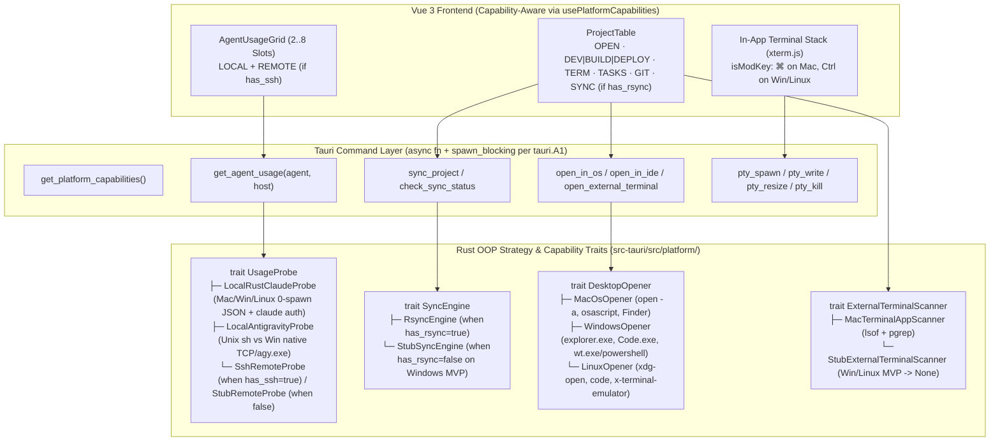

# Research: v2 Uniplatform Architecture (macOS, Windows, Linux) & Capability-Gated OOP Design

Status: amended 2026-10-28

## 1. Start time

2026-10-28 (audited against `v1.36.0`, commit `6c30560`)

## 2. Initial purpose

Evaluate and design the v2 Uniplatform architecture so Aki Dev Sync can ship native **Windows** and **Linux** builds alongside **macOS**.
- **Market / User driver:** High inbound demand from Windows developers asking for a Windows build specifically to monitor real Claude Code and Antigravity quota (`AgentUsage`), manage local projects/tasks (`.akidevsync/notes.json`), and run integrated multi-tab terminals (`portable-pty`).
- **Architectural constraint:** Subsystems that depend on Unix/macOS tools (`rsync`, `ssh`, `lsof`, `osascript`) must **not** block or delay the Windows MVP. When `rsync` or `ssh` is absent on Windows, those features must degrade gracefully via OOP Strategy / Stub traits (`pattern.A4`, `pattern.A6`), preserving 100% of the core value: **Usage Monitoring, Project & Task Management, In-App Terminal, Git Operations, Statusline Customizer, and Remote Control**.

## 3. Strategy

1. **Business & Beachhead Alignment (`RULE-biz.md` §A1–A4, `RULE-docs.md` §A3):** Reconcile the expansion from macOS-only ([docs/biz/backbone.md](../biz/backbone.md)) to a 3-OS Uniplatform v2 without diluting the primary persona.
2. **Static Cross-Compile & OS-Dependency Audit (`RULE-stack-tauri.md` §B4, §B8):** Scan all 37,104 lines of `src-tauri/src/*.rs` and all Vue composables/components in `src/` to classify every OS-coupled call site (`#[cfg]`, `std::os::unix`, `libc`, `Command::new`, `metaKey`).
3. **3-Tier Subsystem Classification:** Partition the app into (Tier 1) Already Cross-Platform, (Tier 2) Core Usage & Terminal needing native Windows/Linux adapters, and (Tier 3) Optional/Capability-Gated (`rsync`/`ssh`/external `Terminal.app` scan) behind OOP Strategy + Stub traits.
4. **Deep-Think & Adversarial Critique (`METHOD-deep-think.md` §B1–B5):** Attack premature abstractions (`pattern.B3`), evaluate native Rust vs POSIX shell probes on Windows, and apply `tauri.B8` Windows runtime verification rules.

## 4. Checklist

- [x] Read `docs/biz/backbone.md`, `RULE-biz.md`, `RULE-stack-tauri.md`, `RULE-pattern-core.md`
- [x] Audit `src-tauri/Cargo.toml` and all `src-tauri/src/*.rs` modules for Unix/macOS-only symbols and subprocess spawns
- [x] Audit `src/` frontend for macOS-only UI labels (`Finder`, `Terminal.app`, `⌘`) and IPC calls (`macos_open`)
- [x] Run `METHOD-deep-think.md` Modules 1–5 on the OOP Strategy / Capability-Gated architecture
- [x] Author execution plan in [docs/plan/v2-uniplatform-windows-linux-mvp.md](../plan/v2-uniplatform-windows-linux-mvp.md)

---

## 5. Result

### 5.1. Executive Summary — How Close Is the Codebase to Windows/Linux Today?

**Conclusion:** Over **80% of Aki Dev Sync's codebase is already cross-platform** (`portable-pty` for ConPTY/Unix PTY, `keep_awake.rs` already has a `#[cfg(windows)]` EcoQoS implementation using `windows-sys`, `axum`/`tokio` for Remote Control, `dirs` + `std::fs` for project/task storage, and `bytes.js` already detects Windows `1024^3` vs macOS `1000^3`).

Only **6 compile-time Unix blockers** in `src-tauri/` prevent `cargo check --target x86_64-pc-windows-msvc` from succeeding today, and **4 runtime seams** need OOP Strategy / Capability traits so Windows and Linux run natively with graceful stubbing when `rsync` or `ssh` is absent.

---

### 5.2. Exact Inventory of Compile-Time Unix Blockers in `src-tauri/`

Static audit of `src-tauri/src/` (`grep -rnE 'std::os::unix|libc::|macos-private-api'`) identified all **6 compile-time blockers** on Windows:

| # | File & Line | Current Code | Why It Fails on Windows | Fix |
|---|---|---|---|---|
| **C-1** | [Cargo.toml](../../src-tauri/Cargo.toml#L17) | `tauri = { version = "2", features = ["macos-private-api"] }` | Feature `macos-private-api` and `titleBarStyle: "Overlay"` are macOS-specific window chrome settings. | Keep `macos-private-api` (Tauri ignores it on non-macOS) and provide a platform-specific `tauri.windows.conf.json` / `tauri.linux.conf.json` override where needed. |
| **C-2** | [conflict.rs](../../src-tauri/src/conflict.rs#L246-L248) | `libc::time_t`, `libc::tm`, `libc::localtime_r(&ts, &mut tm)` | `libc` is declared under `[target.'cfg(unix)'.dependencies]` in `Cargo.toml:37`, and `localtime_r` is POSIX-only. | Gate `localtime_r` with `#[cfg(unix)]` and use `#[cfg(windows)]` CRT `_localtime64_s` (or pure-Rust offset calculation). |
| **C-3** | [control.rs](../../src-tauri/src/control.rs#L3-L10) & [lib.rs](../../src-tauri/src/lib.rs#L6) | `mod control;` in `lib.rs:6` with unconditional `use std::os::unix::fs::PermissionsExt;` and `UnixListener` | `lib.rs:199` gates `control::spawn` with `#[cfg(all(debug_assertions, target_os = "macos"))]`, but `mod control;` at line 6 compiles unconditionally. | Gate `#[cfg(unix)] mod control;` (or gate the Unix socket body inside `control.rs`). |
| **C-4** | [statusline.rs](../../src-tauri/src/statusline.rs#L965) | `use std::os::unix::fs::PermissionsExt;` ( line 965) and `std::os::unix::fs::symlink` (line 1956 test) | `PermissionsExt::from_mode(0o755)` and `unix::fs::symlink` do not exist on Windows. | Wrap `set_permissions(0o755)` in `#[cfg(unix)]` (Windows `.sh` / `.ps1` scripts do not use Unix mode bits). |
| **C-5** | [system.rs](../../src-tauri/src/system.rs#L1757) | `use std::os::unix::fs::PermissionsExt;` in unit test | Unix-only trait import in test module. | Gate with `#[cfg(unix)]`. |
| **C-6** | [pty.rs](../../src-tauri/src/pty.rs#L909) | `is_pid_alive` at line 909 (`unsafe { libc::kill(pid, 0) == 0 }`) and test at line 1497 | `kill_process_group` at line 568 is already `#[cfg(unix)]`, but `is_pid_alive` at line 909 was left un-gated! | Add `#[cfg(unix)]` / `#[cfg(windows)]` (`OpenProcess` + `GetExitCodeProcess == STILL_ACTIVE`) on `is_pid_alive`. |

---

### 5.3. Three-Tier Subsystem Matrix & OOP Strategy Boundaries

#### Tier 1 — Already Cross-Platform (Works on Windows & Linux with Minor Polish)
1. **Project Registry, Config & `.akidevsync/notes.json` Tasks** (`projects.rs`, `project_config.rs`, `project_notes.rs`, `global_note.rs`, `app_paths.rs`):
   - Uses `dirs::home_dir()` (`C:\Users\<user>\.aki\devsync` on Windows, `~/.aki/devsync` on Linux/macOS).
   - **Windows adjustment (`tauri.B8`):** Add a single `normalize_display_path(p: &Path) -> String` helper that strips Windows verbatim `\\?\` prefixes (`\\?\C:\...` $\rightarrow$ `C:\...`) returned by `std::fs::canonicalize`, and ensure no file truncation uses an `append(true)` handle.
2. **In-App Terminal (`pty.rs`, `portable-pty`):**
   - `portable_pty::native_pty_system()` uses **Windows ConPTY** natively on Windows 10/11 and Unix PTY on Linux/macOS.
   - **Adjustments needed:**
     - `default_shell()` in `pty.rs`: on `#[cfg(windows)]`, prefer `pwsh.exe` $\rightarrow$ `powershell.exe` $\rightarrow$ `%COMSPEC%` (`cmd.exe`); on `#[cfg(unix)]`, keep `$SHELL` $\rightarrow$ `/bin/zsh` $\rightarrow$ `/bin/bash`.
     - `pty_cwd()`: on `#[cfg(target_os = "macos")]` keep `/usr/sbin/lsof`; on `#[cfg(target_os = "linux")]` read `/proc/{pid}/cwd` via `std::fs::read_link`; on `#[cfg(windows)]` return the tab's initial project `cwd`.
     - Frontend `isModKey(ev)`: map `⌘` (`metaKey`) on macOS to `Ctrl` (`ctrlKey`) on Windows/Linux (with `Ctrl+C` in terminal copying when selection is non-empty, otherwise sending SIGINT `\x03`, or `Ctrl+Shift+C` / `Ctrl+Shift+V`).
3. **Git Modal Operations (`git.rs`):**
   - Spawns `git` directly; works on macOS, Linux, and Windows (Git for Windows).
4. **Remote Control Server (`web_server.rs`) & Keep-Awake (`keep_awake.rs`):**
   - `web_server.rs` is pure `axum` + `tokio`.
   - `keep_awake.rs:61-95` **already implements** Windows EcoQoS opt-out via `SetProcessInformation(..., ProcessPowerThrottling, ...)`!

#### Tier 2 — Core Must-Have for Windows/Linux MVP: Native Agent Usage Monitoring (`agent_usage/`)
Why does `agent_usage` currently fail on Windows? Because `remote_shell.rs:112` pipes `scripts/get-claudecode-usage.sh` and `scripts/get-antigravity-usage.sh` into `Command::new("sh")` even when `host == "local"`!
- **Solution — Split `Local` vs `Remote` Probe Execution (`pattern.A6`):**
  1. **Claude Code Local Probe (`claudecode_local.rs` — Pure Rust on ALL 3 OSes):**
     - What `scripts/get-claudecode-usage.sh` does locally is 95% reading local JSON files under `${CLAUDE_CONFIG_DIR:-~/.claude}`:
       - Per-account caches: `~/.claude/rate-limits/*.json`
       - Legacy single cache: `~/.claude/rate-limits-cache.json`
       - Identity & tiers: `~/.claude/.claude.json` (`oauthAccount`) and `~/.claude/.credentials.json`
       - Live auth fallback: spawning `claude auth status` (`claude.exe` / `claude.cmd` on Windows — filtered to `.com/.exe/.bat/.cmd` per `tauri.B8`!).
     - Writing the local Claude Code reader in **native Rust** (sharing the exact same JSON output contract so `claudecode.rs` and `AgentUsage.vue` don't change a line!) works natively on **Windows, Linux, and macOS**, AND eliminates spawning `sh` + 6 `python3` processes every 30s on macOS/Linux (`coding.C3` Performance)!
     - For `host != "local"` (remote SSH), `claudecode.rs` continues piping `get-claudecode-usage.sh` over `ssh host sh` (which works from Windows too whenever `ssh.exe` is present!).
  2. **Antigravity Local Probe (`antigravity_local.rs`):**
     - On **macOS & Linux (`#[cfg(unix)]`)**: `get-antigravity-usage.sh` works natively on both macOS (`lsof`) and Linux (`ss`/`netstat`).
     - On **Windows (`#[cfg(windows)]`)**: Native Rust probe (`antigravity_windows.rs`) that:
       - Scans running `language_server_windows_x64.exe` and `agy.exe` processes and their listening localhost TCP ports + `--csrf_token` argv (or queries `reqwest` to `127.0.0.1:<port>/exa.language_server_pb.LanguageServerService/GetUserStatus` and `/RetrieveUserQuotaSummary`).
       - When `agy.exe` is running, runs `agy.exe -p "/usage" --output-format json --log-file <temp>` (with 60s temp-file cache) + reads `~/.gemini/antigravity-cli/usage-cache/<email>.json`, feeding the exact same `parse_antigravity_frames()` normalizer in `antigravity_payload.rs`!

#### Tier 3 — Capability-Gated & Stubbed Subsystems (`rsync`, `ssh`, `osascript`)
Following the owner's explicit direction (*"còn mấy cái phụ thuộc rsync/ssh nếu win không có thì tạm thời coi như mất tính năng đó (stub code, OOP pattern) mà vẫn không mất những tính năng tinh túy"*):
- **1. `SyncEngine` Trait (`RsyncSyncEngine` vs `StubSyncEngine`):**
  - At startup, `PlatformCapabilities::detect()` probes whether `rsync --version` (>= 3.2.4) and `ssh -V` are available in `PATH`.
  - On macOS/Linux (or Windows with cwRsync/MSYS2), `has_rsync = true` $\rightarrow$ `RsyncSyncEngine` runs as today.
  - On stock Windows without `rsync`, `has_rsync = false` $\rightarrow$ `StubSyncEngine`:
    - `check_sync_status` returns an empty/disabled stub immediately (0ms, no subprocess spawn, no error toast spam).
    - `sync_project` returns `Err("Rsync is not installed on this Windows machine. Local project management, Terminal, Git, and Usage Monitoring remain fully available.")`.
    - In Vue (`ProjectTable.vue`, `App.vue`), when `!capabilities.has_rsync`:
      - Background sync polling is skipped automatically (`useRefreshController.js`).
      - The `SYNC` column (`PUSH` / `PULL` buttons) and header `Sync check` switch are hidden (or shown as a compact muted stub badge if the user configures a remote), giving Windows users a clean **Local Project + Terminal + Tasks + Git + Usage** workspace!
- **2. `RemoteShellTransport` (`OpenSshTransport` vs `StubSshTransport`):**
  - Note: Modern Windows 10/11 ships `C:\Windows\System32\OpenSSH\ssh.exe` by default!
  - When `has_ssh = true` (even on Windows!), a Windows user **can** monitor remote Linux Claude Code / Antigravity usage (`AgentUsageSlot.vue` `REMOTE` tab) and open SSH tabs in the in-app terminal!
  - When `has_ssh = false`, `StubSshTransport` returns `AgentUsageResult::unreachable("SSH client not available on this machine")` and the UI hides/disables the `REMOTE` scope tab in `AgentUsageSlot.vue` and the `SSH` config modal button.
- **3. `DesktopOpener` Trait (`MacOsOpener` vs `WindowsOpener` vs `LinuxOpener`):**
  - Replaces `macos_open` and `osascript` in `system.rs`:
    - Open folder: `Finder` (`open <path>`) on macOS $\rightarrow$ `Explorer` (`explorer.exe <path>`) on Windows $\rightarrow$ `Files` (`xdg-open <path>`) on Linux.
    - Open IDE (`VSCode`, `VSCode Insiders`, `Antigravity`, `Cursor`): checks `/Applications/*.app` on macOS; checks `%LOCALAPPDATA%\Programs\...` and `PATHEXT` (`.exe`/`.cmd` per `tauri.B8`) on Windows; checks `PATH` / `/usr/bin` / `~/.local/bin` on Linux.
    - Open External Terminal: `Terminal.app` (`osascript`) on macOS; Windows Terminal (`wt.exe -d <path>`) or `powershell.exe` (`cmd /c start powershell -NoExit -Command "Set-Location ..."`) on Windows; `x-terminal-emulator` / `gnome-terminal` / `konsole` on Linux.
- **4. `ExternalTerminalScanner` Trait (`MacTerminalAppScanner` vs `StubExternalTerminalScanner`):**
  - On macOS, scans `Terminal.app` child processes via `lsof` (`system.rs:1216`) for the slate badge on the `TERM` cell.
  - On Windows & Linux MVP, `StubExternalTerminalScanner` returns `Ok(None)` immediately (only the cyan in-app PTY terminal badge is shown).

---

### 5.4. Deep-Think Critique (`METHOD-deep-think.md` §B1–B5)

1. **Goal Excavation (`think.B1`):**
   - *Immediate goal:* Make Aki Dev Sync compile and run natively on Windows and Linux with full Usage Monitoring, Project/Task Management, In-App Terminal, and Git, while stubbing out `rsync`/`ssh` when absent.
   - *Ultimate goal:* Let any developer on macOS, Windows, or Linux use Aki Dev Sync as their single AI-agent command center (quota monitor + project/task manager + terminal + optional remote sync) from one unified codebase maintainable by a solo developer (`coding.A2`).
2. **Critique — Steelman NOT using Rust `dyn Trait` everywhere (`think.B3` + `pattern.A2`):**
   - *Steelman:* Over-engineering 15 traits for a 3-OS desktop app violates `pattern.A2` (Rule of Three) and `coding.A2` (Single-maintainer friendly).
   - *Attack & Resolution:* Keep the boundary narrow (`pattern.B3` Subtract before you share):
     - Do **not** wrap pure cross-platform modules (`projects.rs`, `project_notes.rs`, `git.rs`, `web_server.rs`, `pty.rs`) in traits.
     - Use traits/strategies **only** at the 4 genuine OS/capability seams (`UsageProbe`, `SyncEngine`, `DesktopOpener`, `ExternalTerminalScanner`), exposed to Vue via **one** `PlatformCapabilities` struct at startup.
3. **Inversion & Pre-Mortem (`think.B3` + `tauri.B8`):**
   - *How could a Windows MVP build fail on first user launch?*
     1. **Spawner `os error 193` (`tauri.B8`):** Calling `Command::new("claude")` or `Command::new("code")` on Windows fails when `claude` is an npm `.cmd` shim (`%APPDATA%\npm\claude.cmd`), because `std::process::Command` on Windows only resolves `.exe`/`.com` automatically unless `.cmd`/`.bat` is resolved via `PATHEXT`! **Mitigation:** Build a single `resolve_windows_bin(name, candidates)` helper in `src-tauri/src/platform/windows.rs` that filters `PATHEXT` to `.com, .exe, .bat, .cmd` (`tauri.B8` rule).
     2. **Console window flashing on Windows (`CREATE_NO_WINDOW`):** Every background `Command::new("git")`, `claude.cmd`, or `agy.exe -p "/usage"` on Windows will flash a black `cmd.exe` console window every 30 seconds unless `creation_flags(0x08000000)` (`CREATE_NO_WINDOW`) is set on `create_command()`! **Mitigation:** In `system::create_command()`, add `#[cfg(windows)] { use std::os::windows::process::CommandExt; c.creation_flags(0x08000000); }` — one funnel fixes the entire app!
     3. **Verbatim path `\\?\C:\...` (`tauri.B8`):** `std::fs::canonicalize` on Windows prefixes `\\?\`, breaking string comparisons with user-configured project paths and `git` arguments. **Mitigation:** Strip `\\?\` in one shared path normalizer.

---

### 5.5. Verification & Corroborating Links

- **Verification:** Static scan of all 23 Rust modules (`src-tauri/src/`) and Vue composables (`src/`) verified exact line numbers for all 6 compile-time Unix blockers and all subprocess/OS call sites. Runtime verification on Windows VM and Linux will follow `tauri.B8` during execution.
- **Corroborating links:**
  - [docs/biz/backbone.md](../biz/backbone.md) — Current macOS-only product boundary to be updated for v2 beachhead expansion
  - [src-tauri/Cargo.toml](../../src-tauri/Cargo.toml) — Existing `portable-pty`, `windows-sys`, and `cfg(unix)` dependencies
  - [src-tauri/src/keep_awake.rs](../../src-tauri/src/keep_awake.rs#L61-L108) — Reference example of clean `macos` / `windows` / `linux` platform module already in this repo
  - [src-tauri/src/system.rs](../../src-tauri/src/system.rs#L6-L19) — `create_command()` single funnel

---

## 6. Decision

- **Action:** Schedule the 6-phase v2 Uniplatform refactor in [docs/plan/v2-uniplatform-windows-linux-mvp.md](../plan/v2-uniplatform-windows-linux-mvp.md).
- **No action:**
  - *Bundling a custom `rsync.exe` binary inside the Windows installer for MVP:* Rejected for MVP (`think.B4` Simplification). Windows users asking for Aki Dev Sync primarily want Usage Monitoring + Local Project/Terminal/Git management; capability-gating `rsync` via `StubSyncEngine` ships the Windows MVP faster with zero third-party binary licensing/antivirus friction, while still enabling `rsync` automatically for power users who install cwRsync/MSYS2/Git-SDK.
- **Cross-references:**
  - [docs/plan/v2-uniplatform-windows-linux-mvp.md](../plan/v2-uniplatform-windows-linux-mvp.md)
  - [docs/plan/done/ag-plan-badge-unification.md](../plan/done/ag-plan-badge-unification.md)
  - [docs/biz/backbone.md](../biz/backbone.md)

## Amendments

- 2026-10-28 · § 5.2 C-3: `mod control;` is at `lib.rs:7`, not `lib.rs:6`.
- 2026-10-28 · § 5.1, § 5.2, § 5.5 ("6 compile-time Unix blockers"): the count overstates. `is_pid_alive` (`pty.rs:909`) is inside `#[cfg(test)]` (`pty.rs:886`), so C-6 blocks `cargo test` on Windows, not `cargo check`/`cargo build`; C-1 is not a compile blocker by its own Fix (keep `macos-private-api`, Tauri ignores it on non-macOS). At most 4 of the 6 block a Windows `cargo check`; C-5 is likewise a unit-test import.
